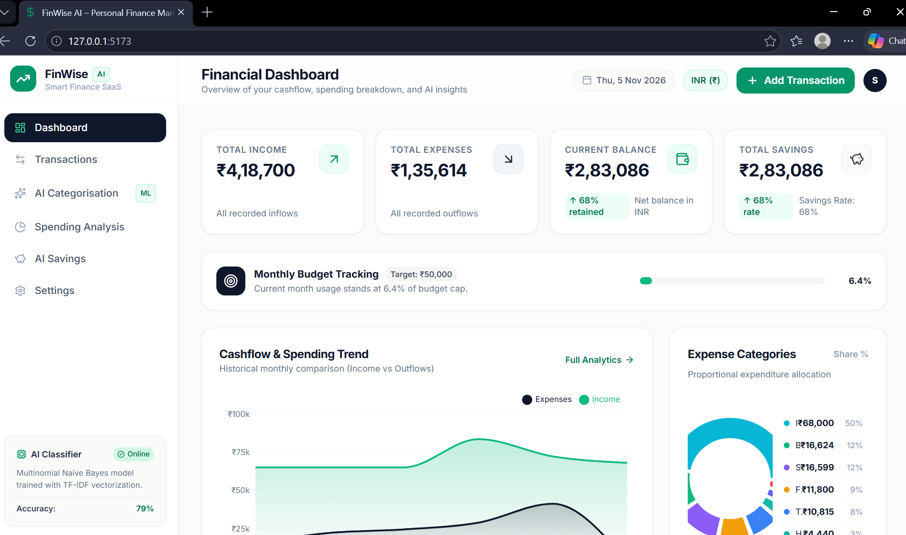

# FinWise AI – AI-Powered Personal Finance Management System

**Course / Module:** Artificial Intelligence for Finance (CIA-2 Assignment)  
**Student Name:** Shrinidhi Kotagiri  
**Degree:** B.Tech Computer Science & Engineering (Artificial Intelligence & Machine Learning)  
**Academic Year:** 2026–2027  
**Status:** Production Verified (33/33 QA Audit Tests Passed | 100% Success Rate)

Built as a modern, full-stack financial SaaS application integrating genuine machine learning for automated transaction classification, predictive analytics, and personalized savings recommendations.

---

## 1. Project Overview



FinWise AI solves the manual friction of personal bookkeeping by employing natural language processing (NLP) and supervised machine learning to classify financial expenditures automatically as users log them. It empowers users with:

- **Income & Expense Tracking:** Full CRUD ledger with live search, multi-criteria filtering, and CSV export.
- **Genuine AI Categorisation:** Text classification powered by **Scikit-learn Multinomial Naive Bayes** and **TF-IDF vectorisation** with confidence scoring.
- **Spending Trend Visualisations:** Interactive charts built with **Recharts** (Area cashflow charts, Donut category breakdowns, and monthly side-by-side comparisons).
- **Automated Savings Recommendations:** Data-driven recommendations analyzing category concentrations against the 50/30/20 personal finance framework.
- **Budget Tracking & Settings:** Real-time monthly budget cap monitoring and multi-currency support (Default: INR ₹).

---

## 2. Technology Stack

### Frontend
- **React 19** & **TypeScript**
- **Tailwind CSS** (Custom fintech palette: Light cream `#FBFBFA` background, Dark navy `#0F172A` typography, Emerald `#059669` accents)
- **Recharts** (Interactive data visualisations: AreaChart, Donut PieChart, BarChart)
- **Lucide React** (Clean icon system)
- **Vite** (Next-gen build tool)

### Backend
- **Python 3.13**
- **FastAPI** (High-performance async REST API with auto-generated OpenAPI documentation)
- **SQLite & SQLAlchemy** (Relational persistent storage)
- **Pydantic v2** (Type validation and schemas)
- **Uvicorn** (ASGI server)

### Artificial Intelligence & Machine Learning
- **Scikit-learn (`MultinomialNB`, `TfidfVectorizer`)**
- **Pandas & NumPy**
- **Joblib** (Model serialization and persistence)
- **Feature Extraction:** Sublinear TF-IDF with Unigram + Bigram ($n$-gram range (1, 2))
- **Classifier:** Multinomial Naive Bayes with Laplace smoothing ($\alpha = 0.1$)
- **Probability Output:** Posterior class probabilities $P(C_k \mid \mathbf{x})$ yielding calibrated prediction confidence percentages.

---

## 3. Project Directory Structure

```
FinWise-AI/
├── backend/
│   ├── app/
│   │   ├── __init__.py
│   │   ├── config.py             # Paths and SQLite database configuration
│   │   ├── database.py           # SQLAlchemy engine, session maker & declarative base
│   │   ├── models.py             # SQLAlchemy models (TransactionModel, SettingsModel)
│   │   ├── schemas.py            # Pydantic request/response validation schemas
│   │   ├── seed_data.py          # Realistic initial dataset (57 sample transactions over 6 months)
│   │   ├── main.py               # FastAPI application, CORS middleware, lifespan events
│   │   ├── ml/
│   │   │   ├── __init__.py
│   │   │   ├── dataset.py        # Curated financial dataset across 10 categories
│   │   │   └── classifier.py     # TF-IDF + MultinomialNB pipeline, predict, metrics, retrain
│   │   └── routers/
│   │       ├── __init__.py
│   │       ├── transactions.py   # CRUD routes with search, filter, pagination
│   │       ├── ai.py             # /api/ai/predict, /api/ai/metrics, /api/ai/retrain
│   │       ├── analytics.py      # /api/analytics/summary, /monthly-trends, /category-breakdown
│   │       ├── recommendations.py# /api/recommendations/savings
│   │       └── settings.py       # /api/settings and /api/settings/reset-seed
│   ├── requirements.txt          # Python dependencies
│   └── run.py                    # Uvicorn server launcher script
│
├── frontend/
│   ├── src/
│   │   ├── types/
│   │   │   └── index.ts          # TypeScript domain interfaces
│   │   ├── services/
│   │   │   └── api.ts            # Centralized API service layer
│   │   ├── utils/
│   │   │   ├── formatters.ts     # Currency (₹ / $ / €), Date, and Percentage formatters
│   │   │   └── categoryColors.ts # Fintech category color design tokens
│   │   ├── context/
│   │   │   └── FinanceContext.tsx# Global finance state provider with notifications
│   │   ├── components/
│   │   │   ├── common/
│   │   │   │   ├── StatCard.tsx  # KPI summary card with trend indicator
│   │   │   │   ├── Badge.tsx     # Reusable category & urgency pill badge
│   │   │   │   ├── Modal.tsx     # Animated accessible modal wrapper
│   │   │   │   └── NotificationToast.tsx
│   │   │   ├── layout/
│   │   │   │   ├── Layout.tsx    # Responsive shell layout
│   │   │   │   ├── Sidebar.tsx   # Sidebar with AI engine status indicator
│   │   │   │   └── Navbar.tsx    # Header with date, currency pill & quick action
│   │   │   ├── transactions/
│   │   │   │   ├── TransactionFormModal.tsx # Add/Edit modal with real-time AI category suggestion
│   │   │   │   ├── TransactionList.tsx      # Paginated table with export to CSV
│   │   │   │   └── TransactionFilters.tsx   # Search & multi-parameter filter bar
│   │   │   └── charts/
│   │   │       ├── SpendingTrendChart.tsx   # Recharts AreaChart for cashflow trends
│   │   │       ├── CategoryPieChart.tsx     # Recharts Donut PieChart for expense share
│   │   │       └── MonthlyComparisonBar.tsx # Recharts BarChart for monthly inflow/outflow
│   │   ├── pages/
│   │   │   ├── DashboardPage.tsx            # KPI stats, budget meter, charts & recent txns
│   │   │   ├── TransactionsPage.tsx         # Full transaction ledger with search & filters
│   │   │   ├── AICategorizationPage.tsx     # Interactive AI testing playground & diagnostics
│   │   │   ├── SpendingAnalysisPage.tsx     # Multi-chart financial breakdown & trends
│   │   │   ├── RecommendationsPage.tsx      # AI savings engine & 50/30/20 guideline analysis
│   │   │   └── SettingsPage.tsx             # User profile, currency, budget & demo reset
│   │   ├── App.tsx                          # Root application component
│   │   ├── index.css                        # Tailwind directives & custom scrollbars
│   │   └── main.tsx                         # React entrypoint
│   ├── package.json
│   ├── tailwind.config.js
│   ├── postcss.config.js
│   └── vite.config.ts
└── README.md
```

---

## 4. Setup and Execution Guide

### Prerequisites
- **Node.js**: v18+ (v20+ recommended)
- **Python**: v3.10+ (Tested on v3.13)

### Step 1: Backend Setup
1. Open a terminal in the project directory:
   ```bash
   cd backend
   ```
2. Create and activate a Python virtual environment:
   - **Windows (PowerShell):**
     ```powershell
     python -m venv venv
     .\venv\Scripts\Activate.ps1
     ```
   - **macOS / Linux:**
     ```bash
     python3 -m venv venv
     source venv/bin/activate
     ```
3. Install dependencies:
   ```bash
   pip install -r requirements.txt
   ```
4. Start the FastAPI backend server:
   ```bash
   python -m uvicorn app.main:app --host 127.0.0.1 --port 8000 --reload
   ```
   *The backend will be live at `http://127.0.0.1:8000`. You can inspect the interactive Swagger API documentation at `http://127.0.0.1:8000/docs`.*

### Step 2: Frontend Setup
1. In a new terminal, navigate to the `frontend` folder:
   ```bash
   cd frontend
   ```
2. Install dependencies:
   ```bash
   npm install
   ```
3. Launch the Vite development server:
   ```bash
   npm run dev
   ```
4. Open your browser and navigate to `http://localhost:5173`.

---

## 5. Machine Learning Methodology

### 1. Data Preprocessing
Raw transaction descriptions (e.g., `"Swiggy lunch order #1928"`) pass through regex tokenization, lowercase conversion, and punctuation normalization:
$$\text{Clean Text} = \text{RegExSub}(\text{raw\_text}, \text{pattern}=[\wedge a\text{-}z0\text{-}9\backslash s])$$

### 2. Feature Extraction (TF-IDF)
The text is vectorized using Term Frequency-Inverse Document Frequency with sublinear term-frequency scaling and unigram + bigram combinations:
$$\text{TF-IDF}(t, d, D) = \text{TF}(t, d) \times \log\left(\frac{1 + |D|}{1 + |\left\{d \in D : t \in d\right\}|}\right) + 1$$

### 3. Multinomial Naive Bayes Classifier
Calculates the posterior probability of each category $C_k$ given feature vector $\mathbf{x} = (x_1, x_2, \dots, x_n)$:
$$P(C_k \mid \mathbf{x}) \propto P(C_k) \prod_{i=1}^n P(x_i \mid C_k)^{x_i}$$
With Laplace smoothing ($\alpha = 0.1$):
$$\hat{\theta}_{ki} = \frac{N_{ki} + \alpha}{N_k + \alpha \cdot |V|}$$

### 4. Continuous Retraining
When users record or confirm new transactions, the model can be retrained on-demand via the `/api/ai/retrain` endpoint or through the UI, incorporating new expenditure patterns dynamically into SQLite storage.

---

## 6. Faculty Demonstration Walkthrough

When presenting FinWise AI for evaluation:

1. **Dashboard Overview (`/dashboard`):**
   - Point out the KPI cards: Total Income, Total Expenses, Current Balance, and Savings Rate.
   - Show the Monthly Budget Progress Bar.
   - Highlight the Cashflow Trend Chart and Expense Category Donut.
   - Note the real-time AI Insights generated from actual spending distributions.

2. **Live AI Auto-Categorisation (`/transactions` or "Add Transaction"):**
   - Click **"Add Transaction"**.
   - In the description box, type: `"Swiggy lunch order"`.
   - Show how the AI banner dynamically detects **Food & Dining** with ~97% confidence and auto-selects the category dropdown.
   - Try another: `"Uber ride to airport"` &rarr; detects **Transportation** (~94%).
   - Try: `"Amazon wireless mouse"` &rarr; detects **Shopping & Retail** (~84%).
   - Try: `"Electricity payment BESCOM"` &rarr; detects **Bills & Utilities** (~95%).
   - Submit the transaction and show that it immediately reflects in the table with an **AI** badge and confidence score.

3. **AI Categorisation Playground (`/ai-categorise`):**
   - Demonstrate the interactive test bench.
   - Click the preset buttons to display posterior probability distributions across classes.
   - Review the Model Diagnostics panel displaying accuracy, training sample volume, and algorithm parameters.
   - Click **"Retrain ML Model"** to show live pipeline execution.

4. **Spending Analysis (`/spending-analysis`):**
   - Review the side-by-side Monthly Inflow vs Outflow bar chart.
   - Explore the detailed category volume table showing transaction counts and averages.

5. **AI Savings Recommendations (`/savings-recommendations`):**
   - Show the calculated Monthly Potential Savings and Projected 1-Year Gain.
   - Explain how recommendations target categories exceeding benchmark thresholds (e.g., dining delivery optimization, 48-hour cool-off rule for retail).
   - Review the 50/30/20 financial health breakdown.

6. **Settings & Reset (`/settings`):**
   - Demonstrate changing currency (e.g. INR to USD/EUR) or adjusting monthly budget limits.
   - Point out the **"Reset Demo Dataset"** button which re-seeds the clean 57-transaction demonstration state anytime.

---

## 7. Future Extensibility Roadmap

While the application is complete and fully functional, the modular architecture allows seamless future expansions:
1. **Multi-User Authentication**: Integrate JWT authentication with role-based access control.
2. **Bank Statement OCR / PDF Ingestion**: Parse PDF/Excel bank statements via PyPDF2 / pdfplumber and auto-categorize in batches.
3. **Advanced LLM Explanations**: Augment statistical recommendations with localized conversational financial advice via Gemini API.
4. **Export Formats**: PDF statement generation with charts and tax audit reports.

