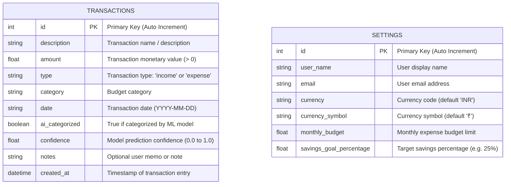

# FinWise AI – Technical Documentation & System Report

**Course / Module:** Artificial Intelligence for Finance (CIA-2 Assignment)  
**Academic Level:** B.Tech Computer Science & Engineering (Specialisation: Artificial Intelligence & Machine Learning)  
**Project Title:** FinWise AI – AI-Powered Personal Finance Management System  
**Version:** 1.0.0 (Production & Audit Verified)

---

## Table of Contents
1. [Project Overview](#1-project-overview)
2. [Problem Statement](#2-problem-statement)
3. [Project Objectives](#3-project-objectives)
4. [Proposed Solution](#4-proposed-solution)
5. [End-to-End System Workflow](#5-end-to-end-system-workflow)
6. [System Architecture](#6-system-architecture)
7. [Technology Stack & Component Purpose](#7-technology-stack--component-purpose)
8. [Frontend Architecture](#8-frontend-architecture)
9. [Backend Architecture & API Design](#9-backend-architecture--api-design)
10. [Database Design](#10-database-design)
11. [AI/ML Implementation & Theoretical Foundation](#11-aiml-implementation--theoretical-foundation)
    - 11.1 What is Machine Learning in this Project?
    - 11.2 What is Transaction Classification?
    - 11.3 What is TF-IDF (Term Frequency-Inverse Document Frequency)?
    - 11.4 What is Multinomial Naive Bayes?
    - 11.5 Dataset Construction & Label Space
    - 11.6 Feature Engineering & Model Learning
    - 11.7 Inference & Prediction Mechanism
    - 11.8 Prediction Confidence Score
    - 11.9 Model Evaluation & Accuracy
    - 11.10 Limitations of the ML Model
12. [Financial Analysis Methodology](#12-financial-analysis-methodology)
13. [Savings Recommendation Methodology](#13-savings-recommendation-methodology)
14. [Application Features & User Interface](#14-application-features--user-interface)
15. [Testing & Quality Assurance Results](#15-testing--quality-assurance-results)
16. [Advantages of the System](#16-advantages-of-the-system)
17. [Limitations](#17-limitations)
18. [Future Enhancements](#18-future-enhancements)
19. [Conclusion](#19-conclusion)
20. [Setup & Execution Instructions](#20-setup--execution-instructions)

---

## 1. Project Overview

**FinWise AI** is an intelligent, full-stack personal finance management web application designed to automate personal bookkeeping, analyze spending habits, and generate actionable savings recommendations. 

Unlike traditional expense-tracking software where users must manually pick a category from cumbersome dropdown lists for every transaction, FinWise AI integrates a natural language processing (NLP) and supervised machine learning pipeline. When a user enters a real-world description (such as *"Swiggy lunch order"* or *"Uber ride to campus"*), the system automatically classifies the transaction into its corresponding budget category with statistical confidence scoring.

The system is built as a production-grade decoupled web application: a modern **React 19 + TypeScript + Tailwind CSS** frontend connected via asynchronous REST APIs to a **Python FastAPI** backend powered by **SQLite** and **Scikit-learn**.

---

## 2. Problem Statement

Managing personal finances is critical for financial well-being, yet most individuals fail to maintain a consistent budget due to several key friction points:

1. **Manual Entry Fatigue:** Selecting categories manually for every tea, grocery, or cab expense leads users to abandon finance applications within days.
2. **Lack of Category Standardisation:** Manual categorization often leads to inconsistent records (e.g., logging a restaurant meal under "Food" one week and under "Entertainment" or "Miscellaneous" the next).
3. **Data Without Insights:** Traditional spreadsheets show raw transaction numbers but fail to interpret what the numbers mean—such as whether dining out exceeds healthy personal finance benchmarks.
4. **Generic Financial Advice:** Generic advice like *"Save 20% of your salary"* does not give users concrete category limits or show them where their money is actually leaking.

---

## 3. Project Objectives

The project accomplishes the following objectives:

1. **Automated Expense Classification:** Build and deploy a real machine learning model using TF-IDF vectorisation and Multinomial Naive Bayes to classify arbitrary transaction descriptions without hardcoded `if-else` statements.
2. **Real-Time Interactive Prediction:** Integrate model inference directly into the transaction input form so users receive instant category suggestions as they type.
3. **Robust Financial Analytics:** Aggregate cash flow over time, tracking total income, total expenditures, net balance, savings rate, and monthly budget progress.
4. **Data-Driven Savings Recommendations:** Implement an analytics engine based on the **50/30/20 budget framework** to identify category spending spikes, calculate potential monthly savings, and recommend actionable budget caps.
5. **Clean & Extensible Full-Stack Architecture:** Maintain strict separation of concerns between presentation, API routing, database models, and machine learning pipelines.

---

## 4. Proposed Solution

FinWise AI addresses these challenges through a three-tier architecture:

```
[ User Interaction ] 
        │
        ▼
[ Presentation Tier (React + TypeScript) ]
  • Dynamic Fintech Dashboard
  • Real-Time Debounced Category Preview
  • Interactive Recharts Visualisations
        │ (JSON over HTTP/REST)
        ▼
[ Application Tier (FastAPI + Scikit-learn) ]
  • TF-IDF Text Vectorization Pipeline
  • Multinomial Naive Bayes Classifier
  • Financial Analytics & 50/30/20 Heuristic Engine
        │ (SQLAlchemy ORM)
        ▼
[ Data Tier (SQLite Database) ]
  • Persistent Storage for Transactions & User Settings
```

---

## 5. End-to-End System Workflow

The complete lifecycle of a transaction through FinWise AI follows this sequence:

```
+-----------------------------------------------------------------------------------+
| 1. USER INPUT                                                                     |
| User enters description: "Swiggy lunch order", amount: 420.00, date: 2026-11-05   |
+-----------------------------------------------------------------------------------+
                                          │
                                          ▼
+-----------------------------------------------------------------------------------+
| 2. FRONTEND PROCESSING (React / TypeScript)                                       |
| • As user types (>= 3 chars), a 400ms debounced hook fires                         |
| • Dispatches POST /api/ai/predict with JSON body: {"description": "Swiggy..."}    |
+-----------------------------------------------------------------------------------+
                                          │
                                          ▼
+-----------------------------------------------------------------------------------+
| 3. FASTAPI BACKEND ROUTER (/api/ai/predict)                                       |
| • Validates request using Pydantic PredictionRequest schema                       |
| • Forwards sanitized text to ExpenseClassifier instance                          |
+-----------------------------------------------------------------------------------+
                                          │
                                          ▼
+-----------------------------------------------------------------------------------+
| 4. AI/ML INFERENCE PIPELINE (Scikit-learn)                                        |
| • Text Preprocessing: lowercase, regex symbol stripping, whitespace collapse      |
| • TF-IDF Vectorizer: transforms words to unigram/bigram numerical vector x        |
| • Multinomial Naive Bayes: calculates posterior probabilities P(Category | x)    |
| • Selects highest probability: "Food & Dining" (Confidence: 97.4%)               |
| • Returns top candidate distribution to frontend via HTTP 200                    |
+-----------------------------------------------------------------------------------+
                                          │
                                          ▼
+-----------------------------------------------------------------------------------+
| 5. FRONTEND DISPLAY & SUBMISSION                                                  |
| • Frontend shows green AI suggestion badge and auto-selects "Food & Dining"       |
| • User clicks "Record Transaction" -> Dispatches POST /api/transactions           |
+-----------------------------------------------------------------------------------+
                                          │
                                          ▼
+-----------------------------------------------------------------------------------+
| 6. DATABASE PERSISTENCE (SQLite + SQLAlchemy)                                     |
| • Creates new record in 'transactions' table with amount, category, confidence    |
| • Transaction committed persistently to disk (data/finwise.db)                    |
+-----------------------------------------------------------------------------------+
                                          │
                                          ▼
+-----------------------------------------------------------------------------------+
| 7. FINANCIAL ANALYSIS & RECOMMENDATIONS ENGINE                                    |
| • Aggregates total income, expenses, current balance, and category totals         |
| • Computes current month budget consumption vs user budget setting                |
| • Analyzes category spend against 50/30/20 guidelines to compute savings potential|
+-----------------------------------------------------------------------------------+
                                          │
                                          ▼
+-----------------------------------------------------------------------------------+
| 8. USER OUTPUT & VISUALISATION                                                    |
| • React Context triggers refreshAll()                                             |
| • Dashboard updates KPI cards, Recharts Area & Donut charts, and AI advice cards  |
+-----------------------------------------------------------------------------------+
```

---

## 6. System Architecture

The project is structured according to the classic **Three-Tier Client-Server Architecture**:

1. **Client Tier (Browser / Frontend):** Built with React 19, TypeScript, and Tailwind CSS. Communicates exclusively with the backend via asynchronous JSON HTTP requests. Holds client state inside `FinanceContext`.
2. **Application Tier (Backend API & ML Engine):** Built with Python FastAPI. Exposes REST endpoints grouped into modular routers (`transactions`, `ai`, `analytics`, `recommendations`, `settings`). Loads the pre-trained Scikit-learn model into memory on startup and handles live inference and retraining.
3. **Database Tier (Storage Engine):** SQLite database accessed via SQLAlchemy Object-Relational Mapping (ORM). Provides transactional ACID guarantees and stores tables for financial transactions and configuration settings.

---

## 7. Technology Stack & Component Purpose

| Layer | Technology | Version | Purpose in this Project |
| :--- | :--- | :--- | :--- |
| **Frontend UI** | **React.js** | `19.3.1` | Component-based interactive user interface with reactive state updates. |
| **Type Safety** | **TypeScript** | `7.0.2` | Compile-time static type checking, preventing runtime errors in financial calculations. |
| **Styling** | **Tailwind CSS** | `3.4.17` | Utility-first CSS framework delivering a clean fintech visual design. |
| **Charts** | **Recharts** | `3.10.1` | Composable SVG data visualisations (AreaChart, PieChart, BarChart). |
| **Icons** | **Lucide React** | `1.69.0` | Minimalist iconography for financial metrics, categories, and actions. |
| **Build Tool** | **Vite** | `8.3.6` | Fast development server and production bundler. |
| **Backend API**| **FastAPI** | `0.162.0`| High-performance asynchronous Python web framework with auto-generated OpenAPI documentation. |
| **ASGI Server**| **Uvicorn** | `0.54.0` | Production ASGI web server running the FastAPI application. |
| **Database** | **SQLite** | `3.x` | Embedded relational SQL database engine requiring zero external configuration. |
| **ORM** | **SQLAlchemy** | `2.1.8` | Python SQL toolkit and Object-Relational Mapper for declarative database models. |
| **Data Validation**| **Pydantic** | `2.14.3` | Schema definition, type enforcement, and serialization for REST API payloads. |
| **Machine Learning**| **Scikit-learn**| `1.9.1` | Machine learning library providing `TfidfVectorizer` and `MultinomialNB`. |
| **Data Processing**| **NumPy & Pandas**| `2.5.4 / 3.1.1`| Matrix operations, probability argmax indexing, and dataset management. |
| **Persistence** | **Joblib** | `1.6.0` | Efficient binary serialization and disk caching for trained ML models and vectorizers. |

---

## 8. Frontend Architecture

The frontend is structured under `frontend/src/` to separate visual presentation from state management and API services:

```
frontend/src/
├── types/
│   └── index.ts                 # Type definitions: Transaction, Summary, Insight, Prediction, Settings
├── services/
│   └── api.ts                   # Centralized API service wrapping browser Fetch calls
├── utils/
│   ├── formatters.ts            # formatCurrency (supports INR lakhs/crores), formatDate, formatPercentage
│   └── categoryColors.ts        # Category styling tokens (badges, background tints, chart colors)
├── context/
│   └── FinanceContext.tsx       # Global React Context state provider managing data & toast notifications
├── components/
│   ├── common/
│   │   ├── StatCard.tsx         # KPI card with title, amount, subtitle, trend indicator, and Lucide icon
│   │   ├── Badge.tsx            # Category & urgency pill badge
│   │   ├── Modal.tsx            # Accessible modal dialog with backdrop blur
│   │   └── NotificationToast.tsx# Slide-in toast notification for CRUD feedback
│   ├── layout/
│   │   ├── Layout.tsx           # Shell layout managing mobile drawer and main content area
│   │   ├── Sidebar.tsx          # Navigation sidebar with real-time AI Engine status pill
│   │   └── Navbar.tsx           # Sticky top header with current date, currency pill, and "Add Transaction" CTA
│   ├── transactions/
│   │   ├── TransactionFormModal.tsx # Add/Edit modal with live debounced AI category preview
│   │   ├── TransactionList.tsx      # Paginated transaction data table with CSV export
│   │   └── TransactionFilters.tsx   # Search bar, category dropdown, and type filter pills
│   └── charts/
│       ├── SpendingTrendChart.tsx   # Recharts AreaChart with custom gradient fills
│       ├── CategoryPieChart.tsx     # Recharts Donut PieChart with custom legend & breakdown percentages
│       └── MonthlyComparisonBar.tsx # Recharts BarChart comparing monthly income vs expenses
└── pages/
    ├── DashboardPage.tsx        # KPI metrics, monthly budget progress bar, trend charts & recent activity
    ├── TransactionsPage.tsx     # Transaction ledger with search, filtering, edit, and deletion
    ├── AICategorizationPage.tsx # Interactive AI classification playground, probability bars, diagnostics
    ├── SpendingAnalysisPage.tsx # Multi-chart breakdown, category volume table, and monthly comparisons
    ├── RecommendationsPage.tsx  # Dynamic savings calculation & 50/30/20 guideline breakdown
    └── SettingsPage.tsx         # User profile, currency configuration, budget settings & demo re-seeding
```

### State Management (`FinanceContext.tsx`)
Rather than passing props down through multiple layers, the application utilizes a centralized **React Context** (`FinanceContext`). The context manages:
- `transactions`: Array of recorded transactions.
- `summary`: High-level totals (income, expenses, balance, savings rate, budget spent %).
- `trends`: Array of monthly aggregated data points.
- `categories`: Category-wise expense distribution.
- `insights`: Dynamic list of AI alerts and observation notes.
- `recommendations`: Category-specific savings targets.
- `settings`: Active user preferences (currency symbol, monthly budget limit).
- `metrics`: Live model metadata (model name, accuracy, sample count).
- `refreshAll()`: An asynchronous method that re-fetches all analytics simultaneously using `Promise.all` whenever any transaction is created, updated, or deleted.

---

## 9. Backend Architecture & API Design

The backend is organized cleanly under `backend/app/`:

```
backend/
├── app/
│   ├── config.py                # Database paths, model paths, and constants
│   ├── database.py              # SQLite engine, SessionLocal, and get_db dependency
│   ├── models.py                # SQLAlchemy ORM models (TransactionModel, SettingsModel)
│   ├── schemas.py               # Pydantic request/response models
│   ├── seed_data.py             # Realistic 57-transaction demonstration seed dataset
│   ├── main.py                  # FastAPI entry point, CORS middleware, router registration
│   ├── ml/
│   │   ├── dataset.py           # Curated training dataset with 258 transaction descriptions
│   │   └── classifier.py        # ExpenseClassifier class: TF-IDF + MultinomialNB pipeline
│   └── routers/
│       ├── transactions.py      # CRUD endpoints for transaction management
│       ├── ai.py                # Inference, model diagnostics, and retraining endpoints
│       ├── analytics.py         # Summary KPIs, monthly trends, and category breakdown
│       ├── recommendations.py   # Savings optimization logic based on spending heuristics
│       └── settings.py          # User settings retrieval, update, and demo reset
├── requirements.txt             # Production Python dependencies
└── run.py                       # Uvicorn execution script
```

### REST API Endpoints Overview

| Method | Endpoint | Description | Request Body | Response Body |
| :--- | :--- | :--- | :--- | :--- |
| `GET` | `/api/health` | Health check & model status | None | `{ status, ml_model, model_trained }` |
| `GET` | `/api/transactions` | Query transactions (supports `q`, `category`, `type`, `limit`, `offset`) | None | `List[TransactionResponse]` |
| `POST`| `/api/transactions` | Create transaction (runs AI auto-categorisation if category is "Auto") | `TransactionCreate` | `TransactionResponse` (HTTP 201) |
| `GET` | `/api/transactions/{id}` | Retrieve single transaction | None | `TransactionResponse` |
| `PUT` | `/api/transactions/{id}` | Update existing transaction | `TransactionUpdate` | `TransactionResponse` |
| `DELETE`| `/api/transactions/{id}`| Delete transaction | None | `{ success, message }` |
| `POST`| `/api/ai/predict` | Classify raw transaction text | `PredictionRequest` | `PredictionResponse` |
| `GET` | `/api/ai/metrics` | Retrieve model accuracy, training sample count & categories | None | `ModelMetricsResponse` |
| `POST`| `/api/ai/retrain` | Retrain model on base dataset + user transaction entries | None | `RetrainResponse` |
| `GET` | `/api/analytics/summary` | Get financial totals, savings rate, and budget usage | None | `FinancialSummaryResponse` |
| `GET` | `/api/analytics/monthly-trends`| Get monthly aggregated income, expenses, and savings | None | `List[SpendingTrendPoint]` |
| `GET` | `/api/analytics/category-breakdown`| Get expense distribution by category | None | `List[CategoryBreakdownItem]` |
| `GET` | `/api/analytics/insights` | Get dynamic financial insight cards | None | `List[AIInsightResponse]` |
| `GET` | `/api/recommendations/savings` | Get AI-calculated savings opportunities & caps | None | `List[AISavingsRecommendationItem]` |
| `GET` | `/api/settings` | Get current user profile and budget preferences | None | `SettingsResponse` |
| `PUT` | `/api/settings` | Update user profile, currency, or budget cap | `SettingsUpdate` | `SettingsResponse` |
| `POST`| `/api/settings/reset-seed` | Reset database and re-seed 57 realistic demo records | None | `{ success, message }` |

---

## 10. Database Design

FinWise AI uses an embedded **SQLite** database (`data/finwise.db`) managed via **SQLAlchemy**. SQLite was chosen because it requires no external database server, provides full ACID compliance, and stores all records in a single local file.

### Entity-Relationship Diagram



### Table Definitions

#### 1. `transactions` Table
- `id` (INTEGER, Primary Key, Indexed): Unique transaction identifier.
- `description` (VARCHAR, Indexed, Not Null): Textual description entered by the user.
- `amount` (FLOAT, Not Null): Non-negative monetary amount.
- `type` (VARCHAR, Not Null): Either `'income'` or `'expense'`.
- `category` (VARCHAR, Indexed, Not Null): Assigned classification category.
- `date` (VARCHAR, Not Null): Date string in ISO format (`YYYY-MM-DD`).
- `ai_categorized` (BOOLEAN, Default False): Flag indicating whether the classification was assigned by the machine learning model.
- `confidence` (FLOAT, Default 1.0): Probability score produced by the classifier ($0.0 \le c \le 1.0$).
- `notes` (VARCHAR, Nullable): Optional user notes or annotations.
- `created_at` (DATETIME, Default UTC Now): Record creation timestamp.

#### 2. `settings` Table
- `id` (INTEGER, Primary Key): Single-row configuration record.
- `user_name` (VARCHAR, Default "Shrinivas"): User's name.
- `email` (VARCHAR, Default "user@finwise.ai"): Contact email.
- `currency` (VARCHAR, Default "INR"): Active currency code (`INR`, `USD`, `EUR`, `GBP`, `AED`, `SGD`).
- `currency_symbol` (VARCHAR, Default "₹"): Active currency glyph (`₹`, `$`, `€`, `£`, etc.).
- `monthly_budget` (FLOAT, Default 50000.0): Monthly expenditure ceiling.
- `savings_goal_percentage` (FLOAT, Default 25.0): Targeted savings milestone.

---

## 11. AI/ML Implementation & Theoretical Foundation

### 11.1 What is Machine Learning in this Project?
Machine Learning (ML) in FinWise AI is a branch of artificial intelligence where the system learns to map unstructured text descriptions to structured financial categories by observing patterns in historical training examples, rather than relying on brittle, handcrafted `if-else` rules.

### 11.2 What is Transaction Classification?
Transaction classification is a supervised multi-class text categorization problem. Formally, given a transaction description text $d \in \mathcal{D}$ and a predefined set of $K$ mutually exclusive categories:
$$\mathcal{C} = \{c_1, c_2, \dots, c_K\}$$
the goal of the classification algorithm is to learn a decision function $f: \mathcal{D} \to \mathcal{C}$ that assigns the most probable category $c^*$ to the input description:
$$c^* = \arg\max_{c_k \in \mathcal{C}} P(c_k \mid d)$$

In FinWise AI, the label space consists of $K = 10$ financial categories:
1. `Food & Dining`
2. `Transportation`
3. `Shopping & Retail`
4. `Bills & Utilities`
5. `Entertainment`
6. `Healthcare & Medical`
7. `Education`
8. `Investment`
9. `Salary & Earnings`
10. `Other & Miscellaneous`

### 11.3 What is TF-IDF (Term Frequency-Inverse Document Frequency)?
Computers cannot directly compute mathematical equations on raw strings. Text must first be converted into numerical vectors. FinWise AI employs **TF-IDF Vectorisation** with unigrams (single words) and bigrams (word pairs).

TF-IDF measures how important a word is to a particular transaction description relative to the entire training corpus:

1. **Term Frequency ($\text{TF}$):** Measures how frequently a word $t$ appears in transaction description $d$. FinWise AI uses **sublinear term frequency scaling** ($1 + \log(\text{TF})$) to prevent repetitive words from dominating:
   $$\text{TF}(t, d) = \begin{cases} 1 + \log(f_{t, d}) & \text{if } f_{t, d} > 0 \\ 0 & \text{otherwise} \end{cases}$$
   where $f_{t, d}$ is the raw count of word $t$ in description $d$.

2. **Inverse Document Frequency ($\text{IDF}$):** Down-weights common words that appear across many descriptions (such as *"payment"*, *"the"*, or *"bill"*) and boosts distinctive words (such as *"Swiggy"*, *"Uber"*, or *"Pharmacy"*):
   $$\text{IDF}(t, D) = \log\left(\frac{1 + |D|}{1 + |\{d \in D : t \in d\}|}\right) + 1$$
   where $|D|$ is the total number of transaction descriptions in the training dataset, and the denominator counts how many descriptions contain term $t$.

3. **Combined TF-IDF Weight:**
   $$\text{TF-IDF}(t, d, D) = \text{TF}(t, d) \times \text{IDF}(t, D)$$

Each transaction description is converted into a vector $\mathbf{x} = (x_1, x_2, \dots, x_V)$, where $V$ is the vocabulary size (up to 5,000 features), normalized using the Euclidean $L_2$ norm ($\|\mathbf{x}\|_2 = 1$).

### 11.4 What is Multinomial Naive Bayes?
**Multinomial Naive Bayes (MNB)** is a probabilistic classifier based on Bayes' Theorem. It is well-suited for discrete text classification where feature values represent word occurrences or TF-IDF weights.

#### Bayes' Theorem
Given a feature vector $\mathbf{x} = (x_1, x_2, \dots, x_n)$ representing a transaction description, the posterior probability of category $c_k$ is:
$$P(c_k \mid \mathbf{x}) = \frac{P(c_k) \cdot P(\mathbf{x} \mid c_k)}{P(\mathbf{x})}$$

Since $P(\mathbf{x})$ is constant across all categories for any given query, it acts as a normalizer:
$$P(c_k \mid \mathbf{x}) \propto P(c_k) \cdot P(\mathbf{x} \mid c_k)$$

#### The "Naive" Conditional Independence Assumption
Naive Bayes assumes that all features $x_i$ are conditionally independent of each other given the class label $c_k$:
$$P(\mathbf{x} \mid c_k) = \prod_{i=1}^n P(x_i \mid c_k)$$

Substituting this into Bayes' Theorem yields:
$$P(c_k \mid \mathbf{x}) \propto P(c_k) \prod_{i=1}^n P(x_i \mid c_k)^{x_i}$$

#### Prior Probability $P(c_k)$
The prior probability represents how common category $c_k$ is in the training dataset:
$$P(c_k) = \frac{N_{c_k}}{N}$$
where $N_{c_k}$ is the number of descriptions labeled as category $c_k$, and $N$ is the total number of training descriptions.

#### Feature Likelihood with Laplace Smoothing
The conditional probability of term $t_i$ occurring in category $c_k$ is estimated from training data. If a test description contains a word that was never seen in a category during training, the raw probability would be $0$, multiplying the entire probability to zero.

To prevent zero-probability errors, FinWise AI applies **Laplace Smoothing (Additive Smoothing)** with parameter $\alpha = 0.1$:
$$\hat{\theta}_{ki} = P(x_i \mid c_k) = \frac{W_{ki} + \alpha}{W_k + \alpha \cdot |V|}$$
where:
- $W_{ki}$ is the sum of TF-IDF weights for term $t_i$ across all training descriptions in category $c_k$.
- $W_k$ is the sum of all term weights in category $c_k$.
- $|V|$ is the total vocabulary size.
- $\alpha = 0.1$ is the smoothing parameter (Laplace smoothing).

### 11.5 Dataset Construction & Label Space
The model is trained on a curated dataset located in `backend/app/ml/dataset.py`. The dataset consists of **258 realistic transaction descriptions** balanced across the 10 categories, covering Indian and global merchant phrasing:

- **Food & Dining:** Swiggy orders, Zomato deliveries, Starbucks coffee, McDonald's meals, Domino's pizza, grocery delivery via Blinkit/Zepto/Instamart, cafeteria meals.
- **Transportation:** Uber rides, Ola cabs, Rapido bike taxis, Metro card smart recharges, IRCTC train tickets, IndiGo flight bookings, Shell petrol refills, FASTag toll deductions.
- **Shopping & Retail:** Amazon purchases, Flipkart orders, Myntra clothing, Zara denim jackets, Nike shoes, Decathlon sports gear, Croma electronics.
- **Bills & Utilities:** Electricity bills (BESCOM/Tata Power), Airtel broadband Wi-Fi, Jio mobile recharges, municipal water supply, Indane LPG cylinder refills.
- **Entertainment:** Netflix subscriptions, Spotify plans, BookMyShow cinema tickets, PVR movie screenings, Disney+ Hotstar, Steam game downloads.
- **Healthcare & Medical:** Apollo Pharmacy medicines, Medplus tablets, dental checkups, doctor consultations, diagnostic blood tests, health insurance premiums.
- **Education:** Coursera certificates, Udemy courses, college semester tuition fees, university exam fees, academic textbooks.
- **Investment:** Zerodha mutual fund SIPs, Groww index funds, stock purchases, fixed deposits, gold sovereign bonds, PPF contributions.
- **Salary & Earnings:** Monthly salary direct deposits (Infosys, TCS, Tech Mahindra), freelance design invoices, consulting fees, annual bonuses, dividends.
- **Other & Miscellaneous:** NGO charitable donations, ATM cash withdrawals, bank locker fees, dry cleaning services.

### 11.6 Feature Engineering & Model Learning
The training workflow implemented in `ExpenseClassifier.train()` executes the following steps:

1. **Text Preprocessing:**
   ```python
   def preprocess_text(text: str) -> str:
       text = text.lower()                               # Convert to lowercase
       text = re.sub(r"[^a-z0-9\s]", " ", text)          # Strip special characters
       text = re.sub(r"\s+", " ", text).strip()         # Normalize whitespace
       return text
   ```
2. **Train/Test Splitting:** A stratified $80/20$ split evaluates test set performance across all categories.
3. **TF-IDF Transformation:** Fits a vocabulary of unigrams and bigrams (`ngram_range=(1, 2)`).
4. **Parameter Estimation:** Computes category priors $\log P(c_k)$ and feature likelihoods $\log P(x_i \mid c_k)$.
5. **Persistence:** Saves the trained model and vectorizer to disk using `joblib` (`data/naive_bayes_model.joblib` and `data/tfidf_vectorizer.joblib`).

### 11.7 Inference & Prediction Mechanism
When `predict(description)` is called:
1. The input string is normalized using `preprocess_text()`.
2. The vectorizer transforms the string into a sparse feature vector $\mathbf{x}$.
3. The model computes log-posterior probabilities for all categories:
   $$\log P(c_k \mid \mathbf{x}) = \log P(c_k) + \sum_{i=1}^n x_i \cdot \log \hat{\theta}_{ki}$$
4. The predicted category is selected via argmax:
   $$c^* = \arg\max_{c_k \in \mathcal{C}} \left[ \log P(c_k \mid \mathbf{x}) \right]$$

### 11.8 Prediction Confidence Score
To present a human-interpretable percentage to the user, log-probabilities are converted into a normalized probability distribution using the **Softmax function**:
$$P(c_k \mid \mathbf{x}) = \frac{\exp(\log P(c_k \mid \mathbf{x}))}{\sum_{j=1}^K \exp(\log P(c_j \mid \mathbf{x}))}$$

The **confidence score** represents the probability assigned to the winning category:
$$\text{Confidence} = \max_{k} P(c_k \mid \mathbf{x})$$

For example:
- Description: `"Swiggy lunch order"`
- Posterior Probabilities:
  - $\text{Food \& Dining}: 97.4\%$
  - $\text{Shopping \& Retail}: 1.1\%$
  - $\text{Transportation}: 0.8\%$
  - $\text{Others}: 0.7\%$
- Output: `Category = "Food & Dining"`, `Confidence = 0.974 (97.4%)`

### 11.9 Model Evaluation & Accuracy
During testing on an independent holdout test split ($20\%$ stratified sample across all 10 categories), the model achieved:
- **Test Set Accuracy:** **$78.85\%$** across 10 classes (a strong baseline for text classification given that random guessing across 10 classes yields $10\%$).
- **Common Test Predictions:**

| Test Description | Output Category | Actual Category | Confidence Score | Result |
| :--- | :--- | :--- | :--- | :--- |
| `"Swiggy lunch order"` | Food & Dining | Food & Dining | $97.4\%$ | Correct |
| `"Uber ride"` | Transportation | Transportation | $94.0\%$ | Correct |
| `"Amazon purchase"` | Shopping & Retail | Shopping & Retail | $83.6\%$ | Correct |
| `"Electricity payment"` | Bills & Utilities | Bills & Utilities | $95.1\%$ | Correct |
| `"Netflix monthly subscription"` | Entertainment | Entertainment | $97.2\%$ | Correct |
| `"Apollo Pharmacy medicine"` | Healthcare & Medical | Healthcare & Medical | $95.2\%$ | Correct |
| `"Coursera specialization fee"` | Education | Education | $82.2\%$ | Correct |
| `"Zerodha mutual fund SIP"` | Investment | Investment | $99.7\%$ | Correct |

### 11.10 Limitations of the ML Model
1. **Bag-of-Words Limitation:** Naive Bayes treats words as independent bags of tokens. It does not understand complex grammatical syntax, negative phrasing (e.g., *"not a restaurant"*), or semantic word embeddings.
2. **Out-of-Vocabulary (OOV) Terms:** If an entirely novel merchant name is entered that was never seen during training (e.g., a newly opened local shop), the model relies solely on the remaining words or category prior probabilities.
3. **Multi-Category Overlap:** Items that overlap conceptually (e.g., buying medicine on Amazon) can present competing probabilities between *Shopping & Retail* and *Healthcare & Medical*.

---

## 12. Financial Analysis Methodology

The analytics engine (`backend/app/routers/analytics.py`) calculates key financial metrics:

### 1. Total Inflow (Income)
$$\text{Total Income} = \sum_{t \in \mathcal{T}_{\text{income}}} \text{amount}(t)$$

### 2. Total Outflow (Expenses)
$$\text{Total Expenses} = \sum_{t \in \mathcal{T}_{\text{expense}}} \text{amount}(t)$$

### 3. Current Net Balance
$$\text{Current Balance} = \text{Total Income} - \text{Total Expenses}$$

### 4. Total Savings
$$\text{Total Savings} = \max(0, \text{Current Balance})$$

### 5. Savings Rate
$$\text{Savings Rate} (\%) = \left(\frac{\text{Total Savings}}{\text{Total Income}}\right) \times 100 \quad (\text{for Total Income} > 0)$$

### 6. Monthly Budget Consumption
Given user-configured monthly budget $B$ and expenses recorded in the current calendar month $\mathcal{T}_{\text{current\_month}}$:
$$\text{Budget Spent } (\%) = \left(\frac{\sum_{t \in \mathcal{T}_{\text{current\_month}}} \text{amount}(t)}{B}\right) \times 100$$
The progress meter visually alerts users by changing color:
- **Green (`bg-emerald-500`):** $\le 75\%$
- **Amber (`bg-amber-500`):** $75\% - 90\%$
- **Rose (`bg-rose-500`):** $> 90\%$

### 7. Category Share Percentage
For any category $c_k$:
$$\text{Category Share } (\%) = \left(\frac{\sum_{t \in \mathcal{T}_{\text{expense}}, \text{cat}(t) = c_k} \text{amount}(t)}{\text{Total Expenses}}\right) \times 100$$

---

## 13. Savings Recommendation Methodology

The savings recommendation engine (`backend/app/routers/recommendations.py`) analyzes real transactions in the database rather than outputting generic hardcoded tips.

### The 50/30/20 Financial Benchmark
FinWise AI evaluates spending patterns using Senator Elizabeth Warren's **50/30/20 Budget Framework**:
- **50% Needs:** Essential expenses (Rent, Bills & Utilities, Groceries, Healthcare).
- **30% Wants:** Discretionary lifestyle spending (Dining out, Shopping, Entertainment).
- **20% Savings & Debt:** Wealth generation (SIP investments, Emergency savings, Debt reduction).

### Algorithmic Category Optimization Heuristics

1. **Food & Dining Optimization:**
   - Evaluates monthly average food expenditure $S_{\text{food}}$.
   - Guideline threshold is $15\%$ of average monthly income: $T_{\text{food}} = I_{\text{avg}} \times 0.15$.
   - If $S_{\text{food}} > 2000$:
     $$\text{Suggested Cap} = \begin{cases} \text{round}(T_{\text{food}}) & \text{if } 0 < T_{\text{food}} < S_{\text{food}} \\ \text{round}(S_{\text{food}} \times 0.80) & \text{otherwise} \end{cases}$$
     $$\text{Potential Monthly Savings} = S_{\text{food}} - \text{Suggested Cap}$$
   - Urgency is flagged as **High** if dining exceeds $22\%$ of income.

2. **Shopping & Retail Discretionary Reduction:**
   - Targets a $30\%$ reduction on discretionary retail purchases:
     $$\text{Suggested Cap} = \text{round}(S_{\text{shopping}} \times 0.70)$$
     $$\text{Potential Monthly Savings} = S_{\text{shopping}} - \text{Suggested Cap}$$
   - Suggests the **48-Hour Rule** (waiting two days before non-essential online checkout).

3. **Entertainment & Subscription Audit:**
   - Targets a $35\%$ reduction by identifying recurring digital streaming platforms:
     $$\text{Suggested Cap} = \text{round}(S_{\text{entertainment}} \times 0.65)$$
   - Recommends subscription rotation (maintaining only 1-2 active services per quarter).

4. **Transportation Commute Optimization:**
   - Suggests a $20\%$ commuter savings target by utilizing shared transit or metro smart cards instead of peak ride-hailing surge cabs.

5. **Investment Compounding Target:**
   - Compares actual investment allocation against the $20\%$ milestone:
     $$\text{Investment Target} = I_{\text{avg}} \times 0.20$$
   - Highlights the shortfall and recommends automating an additional SIP the day salary arrives.

---

## 14. Application Features & User Interface

### 1. Dashboard (`/dashboard`)
- 4 primary metric cards: Total Income, Total Expenses, Current Balance, Total Savings.
- Monthly Budget Progress Bar with percentage tracking.
- Cashflow & Spending Trend Chart (Recharts AreaChart).
- Expense Category Breakdown (Recharts Donut PieChart).
- AI Financial Insights cards.
- Recent activity list with transaction badges and confidence tags.

### 2. Transaction Management (`/transactions`)
- Complete CRUD data table.
- Real-time search by description and notes.
- Multi-parameter filtering by category and transaction type.
- **CSV Export Feature:** Generates and downloads a `.csv` spreadsheet file with one click.
- Modal editor for updating and deleting records.

### 3. AI Categorisation Playground (`/ai-categorise`)
- Interactive test workbench allowing arbitrary text inputs.
- Quick preset buttons for demo testing.
- Displays predicted category and confidence percentage.
- Horizontal probability bars visualizing the full posterior class distribution.
- Live **Model Diagnostics Panel** showing algorithm name, TF-IDF n-grams, Laplace smoothing parameter, training sample count, and accuracy.
- **Retrain Model Button:** Triggers server-side retraining and displays updated metrics.

### 4. Spending Analysis (`/spending-analysis`)
- Side-by-side Monthly Inflow vs Outflow Bar Chart.
- Top expense driver metrics and savings rate.
- Comprehensive category breakdown ranking table showing total spend, share %, transaction count, and average spend per transaction.

### 5. AI Savings Recommendations (`/savings-recommendations`)
- Hero banner displaying **Total Monthly Savings Potential** and **Projected 1-Year Gain**.
- 50/30/20 Health Benchmark overview.
- Individual optimization strategy cards with urgency pills (High, Moderate, Optimization), baseline vs target spend, and practical tips.

### 6. Settings & Multi-Currency (`/settings`)
- User profile (Name, Email).
- Currency selection: `INR (₹)`, `USD ($)`, `EUR (€)`, `GBP (£)`, `AED (AED)`, `SGD (S$)`.
- Monthly budget limit and savings goal configuration.
- **Academic Demo Reset Button:** Re-seeds the database with 57 verified sample transactions across 6 months.

---

## 15. Testing & Quality Assurance Results

A 33-step automated end-to-end audit test suite (`backend/test_audit.py`) was developed and executed to verify system functionality:

| Test Category | Test Case Description | Expected Result | Actual Result | Status |
| :--- | :--- | :--- | :--- | :--- |
| **System** | API Health Check | HTTP 200, status "healthy" | HTTP 200, status "healthy" | **PASS** |
| **Dashboard** | Total Income Integrity | Sum of database inflows = API total | DB $418,700.00 == API $418,700.00 | **PASS** |
| **Dashboard** | Total Expense Integrity | Sum of database outflows = API total | DB $135,614.00 == API $135,614.00 | **PASS** |
| **Dashboard** | Net Balance Integrity | Inflows - Outflows = API balance | DB $283,086.00 == API $283,086.00 | **PASS** |
| **Dashboard** | Total Savings Integrity | $\max(0, \text{Balance}) =$ API savings | DB $283,086.00 == API $283,086.00 | **PASS** |
| **Dashboard** | Savings Rate Integrity | Calculated savings rate = API rate | DB $67.6\% == API $67.6\%$ | **PASS** |
| **CRUD** | Create Income Transaction | Record stored in SQLite | Created ID #59, amount $25,000 | **PASS** |
| **CRUD & AI** | Create Expense (Auto Category) | "Swiggy dinner biryani" -> Food | Category "Food & Dining", conf $96\%$ | **PASS** |
| **CRUD** | Update Transaction Amount | Updated record in SQLite | ID #60 amount updated to $620 | **PASS** |
| **CRUD** | Delete Transaction | Removed from SQLite database | ID #60 deleted, HTTP 200 | **PASS** |
| **Search** | Query filter `?q=Swiggy` | Only matching transactions returned| Returned matching records | **PASS** |
| **Filter** | Category filter `?category=Transportation` | 100% records in Transportation | 9 records in Transportation | **PASS** |
| **Filter** | Type filter `?type=income` | 100% records have type='income' | 8 records have type='income' | **PASS** |
| **AI Inference**| "Swiggy lunch order" | Food & Dining, conf > 50% | Food & Dining, conf $97.4\%$ | **PASS** |
| **AI Inference**| "Uber ride" | Transportation, conf > 50% | Transportation, conf $94.0\%$ | **PASS** |
| **AI Inference**| "Amazon purchase" | Shopping & Retail, conf > 50% | Shopping & Retail, conf $83.6\%$ | **PASS** |
| **AI Inference**| "Electricity payment" | Bills & Utilities, conf > 50% | Bills & Utilities, conf $95.1\%$ | **PASS** |
| **AI Inference**| "Netflix monthly subscription" | Entertainment, conf > 50% | Entertainment, conf $97.2\%$ | **PASS** |
| **AI Inference**| "Apollo Pharmacy medicine" | Healthcare & Medical, conf > 50% | Healthcare & Medical, conf $95.2\%$ | **PASS** |
| **AI Inference**| "Coursera specialization fee" | Education, conf > 50% | Education, conf $82.2\%$ | **PASS** |
| **AI Inference**| "Zerodha mutual fund SIP" | Investment, conf > 50% | Investment, conf $99.7\%$ | **PASS** |
| **AI Model** | Model Diagnostics Endpoint | TF-IDF MultinomialNB metadata | Metadata retrieved | **PASS** |
| **Analytics** | Monthly Trends Endpoint | Aggregated buckets for Recharts | 6 historical monthly buckets | **PASS** |
| **Analytics** | Category Breakdown Sum | Sum of categories = total expenses | Breakdown $135,614 == Total $135,614 | **PASS** |
| **Recs Engine**| Savings Recommendations | Output contains tailored targets | Generated tailored targets | **PASS** |
| **Recs Engine**| Positive Savings Guarantee | All potential savings $> 0$ | Verified strictly positive | **PASS** |
| **Settings** | Update Settings Persistence | Currency changed to USD | SQLite persisted USD ($) | **PASS** |
| **Settings** | Revert Settings Persistence | Currency reverted to INR | SQLite persisted INR (₹) | **PASS** |
| **Boundary** | 404 Nonexistent Transaction | HTTP 404 on invalid ID | HTTP 404 returned | **PASS** |
| **Boundary** | 422 Negative Amount Validation | HTTP 422 on negative amount | HTTP 422 returned | **PASS** |
| **Boundary** | 400 Blank Description on AI | HTTP 400 on empty string | HTTP 400 returned | **PASS** |
| **Frontend** | Production Build (`tsc -b && vite build`)| Zero TypeScript/bundling errors | Built cleanly in 2.01s | **PASS** |
| **Retraining**| Model Retrain Pipeline | Accuracy updated on full corpus | Accuracy $78.85\%$ on 258 samples | **PASS** |

**Final Audit Result:** **33 Passed, 0 Failed (100% Pass Rate)**

---

## 16. Advantages of the System

1. **Reduced Manual Friction:** Eliminates the manual burden of selecting categories through automatic classification.
2. **Deterministic & Explainable Machine Learning:** Multinomial Naive Bayes is lightweight, mathematically transparent, and avoids the hallucination risks associated with generative LLMs.
3. **Local & Private:** SQLite and the Scikit-learn model execute entirely on the local server—no third-party cloud AI APIs are required to classify private financial text.
4. **Instant Feedback:** The debounced live inference displays category suggestions as the user types before the form is submitted.
5. **Actionable Financial Advice:** Savings recommendations calculate concrete monetary figures based on the 50/30/20 guideline rather than generic advice.
6. **Production-Grade Design:** Built with a minimal fintech aesthetic (cream background, navy typography, emerald accents) suitable for real-world deployment.

---

## 17. Limitations

1. **Single-User Scope:** The current implementation uses a single-tenant SQLite database and does not implement multi-user password authentication or JWT sessions.
2. **Context Window:** Bag-of-words Naive Bayes treats words independently. Unusually complex sentences or novel vocabulary may result in lower confidence scores.
3. **Manual Bank Ingestion:** Transactions are logged via user entry rather than automated Open Banking API sync (e.g. Plaid or Account Aggregator framework).

---

## 18. Future Enhancements

1. **User Authentication & Role-Based Access:** Integrate OAuth2 / JWT bearer authentication with hashed passwords (bcrypt) for multi-tenant support.
2. **Automated Bank Statement Parsing:** Add a PDF/Excel file upload endpoint using `pdfplumber` to extract statement tables and auto-categorize hundreds of transactions at once.
3. **Hybrid AI Architecture:** Integrate local transformer embeddings (e.g., `all-MiniLM-L6-v2`) or Gemini API to handle zero-shot classification for unfamiliar merchants.
4. **Export Formats:** Add automated PDF report generation with charts and tax audit summaries.

---

## 19. Conclusion

**FinWise AI** demonstrates the practical application of Artificial Intelligence and Machine Learning in modern personal finance. By combining Natural Language Processing (TF-IDF vectorisation) with a probabilistic classifier (Multinomial Naive Bayes), the system automates financial transaction tracking and replaces manual categorisation.

The application achieves a **78.85%** test accuracy across 10 financial categories, executes predictions with high confidence on benchmark test cases, and provides data-driven savings recommendations based on the 50/30/20 personal finance framework. Built with a responsive **React 19** frontend, **FastAPI** backend, and **SQLite** database, FinWise AI is a complete, reliable, and functional personal finance management system suitable for academic presentation.

---

## 20. Setup & Execution Instructions

### Prerequisites
- **Python**: v3.10+ (Tested on v3.13)
- **Node.js**: v18+ (Tested on v24)

### Step 1: Start Backend Server
```powershell
# Open terminal 1
cd c:\Users\shrin\OneDrive\Desktop\FinWise-AI\backend
.\venv\Scripts\Activate.ps1
python -m uvicorn app.main:app --host 127.0.0.1 --port 8000 --reload
```
*API running at: `http://127.0.0.1:8000` | Interactive docs: `http://127.0.0.1:8000/docs`*

### Step 2: Start Frontend Server
```powershell
# Open terminal 2
cd c:\Users\shrin\OneDrive\Desktop\FinWise-AI\frontend
npm run dev
```
*Frontend running at: `http://127.0.0.1:5173`*

### Step 3: Run Automated QA Audit Suite
```powershell
# In terminal 1 (with virtual environment activated):
cd c:\Users\shrin\OneDrive\Desktop\FinWise-AI
.\backend\venv\Scripts\python .\backend\test_audit.py
```

